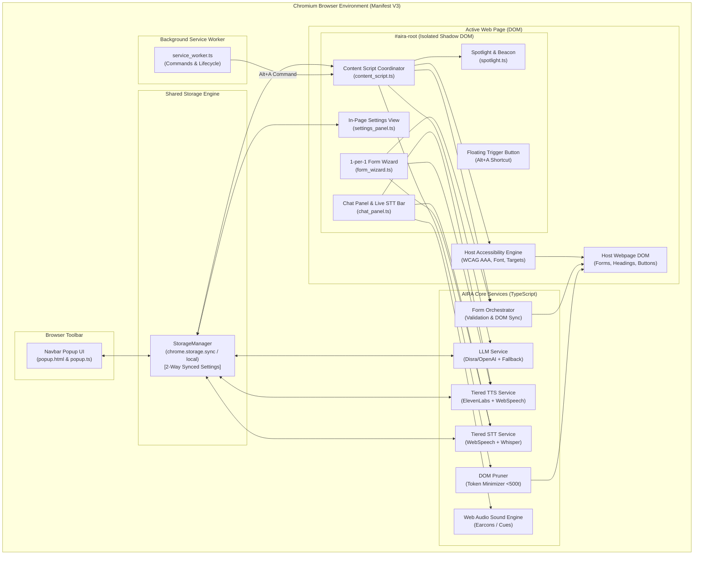
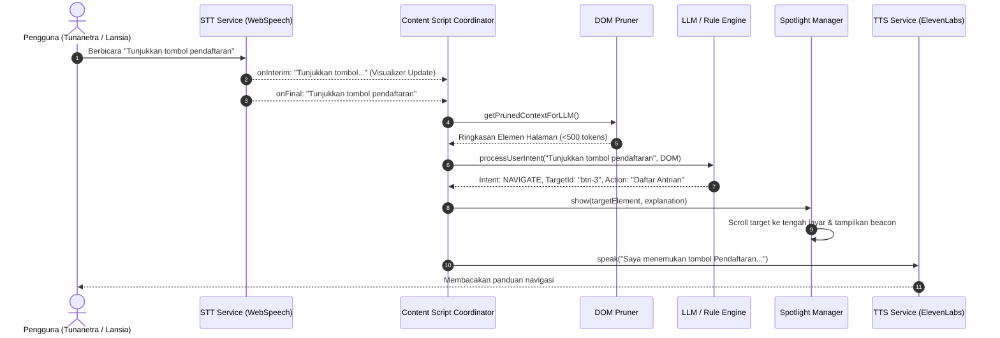
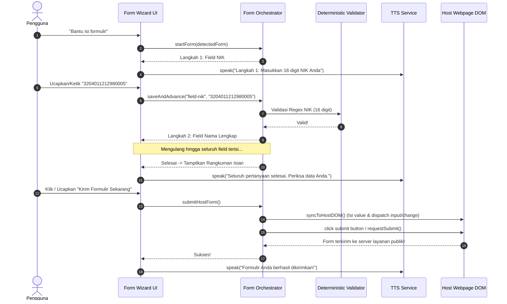

# Dokumen Desain Teknis (DESIGN.md)
# AIRA: Adaptive Interface and Responsive Assistance for Web Navigation and Form Completion

> **Proyek**: AIRA Browser Extension (Chromium Manifest V3)  
> **Kompetisi**: IFEST 2026 (Informatics Festival)  
> **Tema**: *Tech for Human Connections*  
> **Subtema**: Accessibility, Receiver & Provider  
> **Tim Pengembang**: Kapal Lawut (Institut Teknologi Bandung)  
> **Status Dokumen**: Sesuai Implementasi Basis Kode Saat Ini (*As-Built Architecture*)  
> **Versi**: 1.0.0 (Maret 2026)

---

## 1. Ringkasan Eksekutif & Identitas Proyek

### 1.1 Latar Belakang & Masalah
Di era transformasi digital, layanan publik mendasar di Indonesia (pendaftaran BPJS Kesehatan, antrian faskes, administrasi kependudukan/Dukcapil, hingga bansos) telah beralih ke platform web digital. Namun, sebagian besar antarmuka web pemerintah dan publik masih menghadapi kendala aksesibilitas yang berat:
- Formulir birokrasi yang panjang dan membingungkan dengan puluhan *field* dalam satu halaman (*cognitive overload*).
- Minimnya dukungan navigasi bagi penyandang tunanetra dan disabilitas motorik yang mengandalkan suara atau pembaca layar (*screen reader*).
- Kurangnya penjelasan istilah resmi (seperti NIK, faskes rujukan, nomor kepesertaan) dalam bahasa awam.
- Kontras warna yang tidak memenuhi standar WCAG, serta ukuran tombol yang sulit diakses oleh lansia (*presbyopia* dan penurunan ketangkasan motorik).

### 1.2 Solusi: AIRA
**AIRA** (*Adaptive Interface and Responsive Assistance*) hadir sebagai lapisan asistensi adaptif di sisi peramban (*client-side browser extension*) berbasis Chromium Manifest V3. Tanpa memerlukan modifikasi apapun pada server atau kode sumber website host, AIRA secara cerdas:
1. Menangkap dan meringkas struktur halaman web (*DOM perception*) dengan konsumsi token minimal (<500 token).
2. Membimbing pengguna mengisi formulir kompleks satu per satu (*1-by-1 Guided Form Wizard*) melalui dialog santun.
3. Menyediakan navigasi suara penuh (*Voice-Only Mode*) yang memungkinkan seluruh alur web dioperasikan tanpa mouse.
4. Menerapkan adaptasi aksesibilitas langsung pada halaman web yang sedang dibuka (WCAG 2.1 AAA High Contrast, penskalaan teks hingga 150%, target sentuh hingga 64px, dan *sensory shield*).
5. Menjalankan sinkronisasi deterministik ke elemen formulir asli dan memicu pengiriman data formulir (*end-to-end host submission*).

---

## 2. Prinsip Desain Arsitektur (Architectural Principles)

1. **Non-Intrusive & Isolated Presentation**:
   Seluruh antarmuka AIRA diinjeksikan ke dalam **Shadow DOM** (`#aira-root`) dengan mode `open`. Hal ini memastikan *style encapsulation* mutlak: CSS bawaan website host tidak merusak tampilan AIRA, dan CSS AIRA tidak merusak layout asli website.
2. **Deterministic Host Synchronization**:
   Pengisian data bukan sekadar manipulasi atribut visual, melainkan pengisian nilai ke elemen input asli dengan memicu rantai event framework reaktif modern (`focus`, `input`, `change`, `blur`), serta deteksi tombol submit asli (`requestSubmit()` atau `click()`).
3. **Token Minimization & Cost Efficiency**:
   Ekstraktor DOM membuang seluruh elemen *non-essential* (script, style, SVG, iklan, elemen tak terlihat), merangkum pohon DOM menjadi representasi semantik ringkas (<500 tokens) sebelum dikirimkan ke Large Language Model (LLM).
4. **Graceful Degradation (Offline & No-LLM Mode)**:
   Sistem tidak boleh berhenti berfungsi jika API Key LLM kosong atau terjadi kegagalan jaringan. AIRA menyediakan mesin inferensi lokal berbasis aturan (*rule-based DOM parser* dan *fuzzy keyword matching*) yang tetap memandu formulir, navigasi, dan pembacaan suara.
5. **Tiered Provider Architecture (TTS & STT)**:
   - **TTS**: Suara alami ElevenLabs (Multilingual v2) sebagai prioritas utama, dengan *fallback* otomatis ke Web Speech Synthesis API (`id-ID`) jika kuota habis atau API key belum diisi.
   - **STT**: Chrome Web Speech API bawaan untuk latensi instan dan *live transcription* kata-per-kata, serta opsi OpenAI Whisper API untuk akurasi tinggi.
6. **Zero-Asset Offline Feedback (Audio Cues/Earcons)**:
   Seluruh feedback suara status (mikrofon aktif, suara dikenali, sukses, error) disintesis secara real-time via Web Audio API tanpa bergantung pada file MP3/WAV eksternal.

---

## 3. Arsitektur Tingkat Tinggi (High-Level Architecture)



---

## 4. Struktur Direktori & Peran Komponen

```
c:\ITB\Competition\aira\
├── package.json              # Definisi dependensi & skrip kompilasi Bun
├── tsconfig.json             # Konfigurasi TypeScript (ESNext, Strict Type Safety)
├── build.ts                  # Skrip build otomatis menggunakan Bun.build
├── public/
│   ├── manifest.json         # Chromium Extension Manifest V3
│   ├── popup/
│   │   ├── popup.html        # Antarmuka Pengaturan Navbar
│   │   └── popup.css         # Styling Pengaturan Navbar
│   └── demo/
│       ├── portal_layanan_publik.html # Portal simulasi interaktif (Dukcapil/Faskes)
│       └── portal.css        # Styling portal pengujian
├── src/
│   ├── types/                # Definisi Tipe TypeScript
│   │   ├── index.ts          # Tipe konfigurasi (AiraSettings, ChatMessage, Earcons)
│   │   ├── dom.ts            # Tipe ekstraksi DOM (FormField, PageDOMOverview)
│   │   └── llm.ts            # Tipe request/response LLM & AIRAIntentResult
│   ├── shared/               # Modul Infrastruktur & Utilitas
│   │   ├── constants.ts      # Default settings, storage keys, & Regex validasi
│   │   ├── storage.ts        # StorageManager (Sinkronisasi 2 arah Chrome Storage)
│   │   └── sound_effects.ts  # Web Audio API Engine (Sintesis 6 earcon offline)
│   ├── services/             # Layanan Logika Bisnis & Mesin Inferensi
│   │   ├── dom_pruner.ts     # Ekstraksi semantik & kompresi token DOM
│   │   ├── llm_service.ts    # Komunikasi OpenAI-compatible & Fallback lokal
│   │   ├── form_orchestrator.ts # Wizard form 1-per-1, validasi & sinkronisasi DOM
│   │   ├── host_accessibility.ts # Injeksi adaptasi WCAG AAA ke halaman host
│   │   ├── tts_service.ts    # Tiered Text-to-Speech (ElevenLabs + WebSpeech)
│   │   └── stt_service.ts    # Tiered Speech-to-Text (Live WebSpeech + Whisper)
│   ├── content/              # Komponen UI Injeksi Shadow DOM
│   │   ├── content_script.ts # Koordinator utama & manajemen alur Voice-Only
│   │   ├── content_style.css # Desain Sistem WCAG AAA & Figma Hi-Fi Tokens
│   │   ├── chat_panel.ts     # Panel percakapan, live transcription, & riwayat
│   │   ├── settings_panel.ts # Panel pengaturan in-page tersinkronisasi
│   │   ├── form_wizard.ts    # Modal panduan formulir per langkah & rangkuman
│   │   └── spotlight.ts      # Pointer visual & sorot navigasi terpandu
│   ├── popup/
│   │   └── popup.ts          # Logika popup toolbar (uji koneksi, sinkronisasi)
│   └── background/
│       └── service_worker.ts # Service worker Manifest V3 (lifecycle & shortcuts)
└── dist/                     # Direktori hasil kompilasi siap muat di browser
```

---

## 5. Rincian Modul & Implementasi Komponen

### 5.1 Shared Layer (`src/shared/`)

#### 5.1.1 StorageManager (`storage.ts`)
- **Fungsi**: Menjamin integritas konfigurasi pengguna di seluruh konteks ekstensi (Popup Toolbar dan In-Page Content Script).
- **Mekanisme**:
  - Memprioritaskan `chrome.storage.sync` (tersinkron antar-perangkat Google Chrome) dengan fallback ke `chrome.storage.local`.
  - Fallback aman ke `window.localStorage` jika dijalankan di luar lingkungan ekstensi.
  - Mengimplementasikan pola **Observer** melalui listener `chrome.storage.onChanged` dan `window.addEventListener('storage')`, memancarkan pembaruan data secara reaktif ke semua subscriber tanpa perlu me-reload halaman.

#### 5.1.2 SoundEffectsEngine (`sound_effects.ts`)
- **Fungsi**: Menyediakan umpan balik auditori (*earcons*) instan bagi pengguna tunanetra dan lansia.
- **Sintesis Audio 100% Offline (Web Audio API)**:
  1. `LISTEN_START`: Gelombang sinus naik 440 Hz (A4) ke 880 Hz (A5) selama 150 ms saat mikrofon mulai merekam.
  2. `LISTEN_STOP`: Nada ganda lembut 700 Hz melandai ke 520 Hz selama 120 ms saat suara tertangkap.
  3. `SUCCESS`: Akord mayor C5 (523.25 Hz) - E5 (659.25 Hz) - G5 (783.99 Hz) - C6 (1046.50 Hz) saat formulir selesai atau aksi berhasil.
  4. `ERROR`: Gelombang *sawtooth* menurun dari 260 Hz ke 190 Hz selama 250 ms saat validasi format gagal.
  5. `STEP`: Tik sinus lembut 800 Hz (60 ms) saat berpindah langkah form atau klik navigasi.
  6. `CLICK`: Nada segitiga renyah 1200 Hz ke 600 Hz (40 ms).

#### 5.1.3 Aturan Validasi Deterministik (`constants.ts`)
- **NIK**: Regex `/^[0-9]{16}$/` dengan sanitasi pembuangan karakter non-digit dan pembatasan 16 digit.
- **Telepon / WhatsApp**: Regex `/^(\+62|62|0)8[1-9][0-9]{6,10}$/` dengan sanitasi hanya angka dan tanda plus.
- **Email**: Regex `/^[^\s@]+@[^\s@]+\.[^\s@]+$/`.
- **Tanggal**: Regex format `YYYY-MM-DD` atau `DD/MM/YYYY`.

---

### 5.2 Perception Layer (`src/services/dom_pruner.ts`)

- **Tujuan**: Mengurangi konsumsi token LLM dari ribuan baris HTML kotor menjadi representasi semantik padat (<500 token).
- **Algoritma Pruning & Filtering**:
  1. **Deteksi Visibilitas Ketat**: Mengecek `display !== 'none'`, `visibility !== 'hidden'`, `opacity > 0`, ukuran bounding box `width > 0 && height > 0`, serta tidak beratribut `aria-hidden="true"`.
  2. **Isolasi Ekstensi**: Mengabaikan elemen di dalam kontainer `#aira-root`.
  3. **Pencarian Label Input Multi-Tingkat (6-Level Heuristics)**:
     - Level 1: `label[for="input-id"]`
     - Level 2: `input.closest('label')`
     - Level 3: Atribut `aria-label` atau elemen yang dirujuk oleh `aria-labelledby`
     - Level 4: Atribut `placeholder`
     - Level 5: *Preceding sibling* elemen teks yang berdekatan
     - Level 6: Fallback atribut `name` atau `id`
  4. **Pendaftaran Elemen Id**: Menandai elemen target dengan atribut `data-aira-id="btn-X"` atau `data-aira-id="field-X"` dan mencatatnya ke dalam `elementMap` memori.
  5. **Payload Formatting**: Menghasilkan struktur teks ringkas yang merangkum judul halaman, struktur heading (`h1-h3`), cuplikan paragraf utama, daftar tombol aksi, dan daftar input formulir beserta tipe dan status wajibnya.

---

### 5.3 Reasoning & Semantic Layer (`src/services/llm_service.ts`)

- **Protokol**: Kompatibel dengan OpenAI Chat Completions API (`POST /v1/chat/completions`).
- **Endpoint Default**: `https://9r.disra.net/v1/chat/completions` dengan model default `cx/gpt-5.6-luna`.
- **Ekstraksi Maksud Pengguna (Intent Extraction)**:
  - Mengirim prompt sistem ketat dengan mode JSON (`response_format: { type: 'json_object' }`, temperature `0.1`):
    ```json
    {
      "intent": "NAVIGATE" | "FILL_FORM" | "SUMMARIZE" | "SETTINGS" | "CHAT",
      "targetId": "string ID elemen dari daftar, atau null",
      "explanation": "Penjelasan singkat santun dalam Bahasa Indonesia",
      "actionName": "Nama tombol/aksi",
      "confidence": 0.0 - 1.0
    }
    ```
- **Fallback Rule-Based (Graceful Local Degradation)**:
  - Jika API key tidak diisi atau request gagal:
    - Kata kunci `ringkas`, `rangkum`, `ada apa` -> `SUMMARIZE` (menghasilkan ringkasan statistik jumlah form & tombol).
    - Kata kunci `isi form`, `formulir`, `daftar`, `input` -> `FILL_FORM` (memilih form pertama yang terdeteksi).
    - Kata kunci `kontras`, `suara`, `pengaturan` -> `SETTINGS`.
    - Pencarian tombol menggunakan algoritma *fuzzy keyword matching* berbobot terhadap daftar elemen yang diekstrak `domPruner`.
    - Penjelasan istilah birokrasi beralih ke kamus lokal terkurasi (NIK, BPJS, Nama, Nomor Telepon, Alamat).

---

### 5.4 Audio & Speech Engines (`tts_service.ts` & `stt_service.ts`)

#### 5.4.1 Tiered Text-to-Speech (`tts_service.ts`)
1. **Tier 1 (ElevenLabs API)**:
   - Endpoint: `https://api.elevenlabs.io/v1/text-to-speech/{voiceId}`
   - Model: `eleven_multilingual_v2`
   - Voice ID Default: `pNInz6obpgDQGcFmaJgB` (suara alami Bahasa Indonesia).
   - Pengaturan: `stability: 0.5`, `similarity_boost: 0.75`.
   - Menghasilkan respon audio streaming via `URL.createObjectURL(blob)`.
2. **Tier 2 (Web Speech Synthesis Fallback)**:
   - Jika ElevenLabs API key kosong atau request gagal, sistem otomatis beralih ke sintesis suara bawaan browser tanpa menghentikan interaksi.
   - Memilih suara `id-ID` (Google Bahasa Indonesia, Microsoft Gadis/Ardi) dengan parameter `rate: 1.0` dan `pitch: 1.0`.
   - Mengelola event `onend` untuk memicu siklus pendengaran berulang pada Mode Suara Penuh (*Voice-Only Loop*).

#### 5.4.2 Tiered Speech-to-Text (`stt_service.ts`)
1. **Penyedia Default (Chrome Web Speech Recognition)**:
   - Mengaktifkan `interimResults = true` untuk memberikan **transkripsi langsung secara real-time** pada bilah visualizer saat pengguna masih berbicara.
   - Bahasa pengenalan disetel ke `id-ID`.
   - Mengirim event `onInterim` untuk tampilan visual, dan `onFinal` saat jeda bicara terdeteksi.
2. **Penyedia Sekunder (OpenAI Whisper API)**:
   - Merekam audio pengguna via `navigator.mediaDevices.getUserMedia` dan `MediaRecorder` ke dalam format `audio/webm`.
   - Mengunggah rekaman via multipart `FormData` ke endpoint `/v1/audio/transcriptions` menggunakan model `whisper-1` dan parameter `language: id`.

---

### 5.5 Form Orchestration & Host Sync (`src/services/form_orchestrator.ts`)

- **Konsep 1-per-1 Chunking**:
  Mengurai formulir birokrasi yang panjang menjadi pertanyaan tunggal yang disajikan bertahap di tengah layar.
- **Penyimpanan State & Atomic Advance**:
  - Metode `saveAndAdvance(fieldId, rawValue)` memvalidasi data dan menaikkan `currentStepIndex` dalam satu siklus atomik. Hal ini mengeliminasi bug pengulangan pertanyaan ganda (*double prompt*).
- **Sinkronisasi Deterministik ke DOM Asli (`syncToHostDOM`)**:
  - Menemukan elemen HTML asli via `data-aira-id`.
  - Memberikan fokus (`el.focus()`), mengisi nilai (`el.value = val`).
  - Memicu event sintetik `Event('input', { bubbles: true })` dan `Event('change', { bubbles: true })` agar state framework reaktif (React, Vue, Angular) terupdate sempurna.
  - Melepas fokus (`el.blur()`).
- **End-to-End Host Submission (`submitHostForm`)**:
  1. Menjalankan sinkronisasi data seluruh kolom ke DOM.
  2. Mendeteksi elemen tombol submit asli (`button[type="submit"]`, `input[type="submit"]`) dan memicu `.click()`.
  3. Jika tombol tidak ditemukan, memanggil metode form asli `formEl.requestSubmit()` atau `formEl.submit()`.
  4. Membunyikan earcon sukses (`soundEffects.playSuccess()`).

---

### 5.6 Host Page Accessibility Engine (`src/services/host_accessibility.ts`)

- **Tujuan**: Menerapkan standar WCAG 2.1 AAA langsung ke halaman web publik yang sedang dikunjungi pengguna, bukan hanya pada widget AIRA.
- **Injeksi Dinamis**: Memasukkan elemen `<style id="aira-host-accessibility-style">` pada dokumen utama.
- **Adaptasi yang Didukung**:
  1. **Mode Kontras Tinggi (High Contrast WCAG 2.1 AAA)**:
     - Latar belakang: `#000000` pekat.
     - Teks, ikon, dan garis batas: `#FFE600` (kuning tajam) dengan rasio kontras mencapai **19.5:1** (jauh melampaui batas minimal AAA yaitu 7:1).
     - Tombol dan link aksi: Kotak kuning tebal berteks hitam pekat (`#000000`).
     - Cincin fokus (*focus ring*): Garis putih ganda 4px dengan offset 3px dan bayangan hitam.
  2. **Penskalaan Ukuran Teks (Font Scaling)**:
     - `normal`: 100% ukuran asli.
     - `large` (Lansia): HTML base `118%`, teks paragraf `1.15em`, line-height `1.65`.
     - `xlarge` (Sangat Besar): HTML base `135%`, teks paragraf `1.3em`, line-height `1.8`, letter-spacing `0.02em`.
  3. **Ukuran Kontrol & Target Sentuh (Touch Targets)**:
     - `default`: Target minimal `44px`.
     - `large` (Lansia): Target minimal `52px` dengan bantalan vertikal 10px.
     - `xlarge` (Ramah Disabilitas Motorik): Target minimal `64px` dengan bantalan vertikal 14px dan margin pemisah antar-tombol 6px.
  4. **Sensory Shield (Redam Gerakan & Kedipan)**:
     - Menerapkan `animation-duration: 0.001ms !important` dan `transition-duration: 0.001ms !important` untuk melindungi pengguna dengan sensitivitas sensorik atau vestibular disorder.

---

### 5.7 In-Page UI Components (`src/content/`)

#### 5.7.1 Floating Trigger Button & Alt+A Shortcut (`content_script.ts`)
- Tombol melayang di pojok kanan bawah dengan gradien biru elegan (`#007DFF` ke `#0254B8`), ikon AIRA, dan lencana dinamis `Suara` saat Voice-Only Mode aktif.
- Shortcut global keyboard **`Alt + A`** membuka panel dan langsung mengaktifkan mikrofon untuk interaksi bebas-tangan.

#### 5.7.2 Chat Assistant Panel (`chat_panel.ts`)
- **Header**: Status koneksi (*Asisten Siap* / *Voice Only Aktif*), tombol toggle mode suara, tombol mute bicara instan, dan tombol perkecil.
- **Navigasi Tab**: Tab *Percakapan & Bantuan* dan Tab *Pengaturan*.
- **Aliran Pesan (Full Interaction Log)**: Menampilkan pesan user, assistant, dan status sistem secara kronologis lengkap dengan penanda waktu lokal Indonesia dan tombol *Dengarkan Ulang*. Setiap interaksi Form Wizard juga dicatat ke sini.
- **Quick Action Chips**: Tombol cepat *📖 Ringkas Halaman*, *✍️ Bantu Isi Formulir*, dan *🎯 Cari Menu Layanan*.
- **Live STT Visualizer Bar**: Menampilkan bilah gelombang audio bergerak dan teks ucapan pengguna saat kata demi kata diucapkan.
- **Input Bar**: Tombol mikrofon interaktif, kolom input teks responsif, dan tombol kirim.

#### 5.7.3 Form Wizard Dialog (`form_wizard.ts`)
- **Modal Dialog Terpusat**: Muncul dengan backdrop gelap semi-transparan.
- **Indikator Progres**: Bilah progres visual (`Langkah X dari Y - Z% Selesai`).
- **Judul & Tombol Dengar**: Menampilkan pertanyaan dengan tombol speaker untuk membacakan pertanyaan ulang.
- **Kotak Penjelasan Awam**: Penjelasan ramah konteks field (misal rujukan KTP/KK).
- **Input & Big Voice Button**: Kolom input besar yang otomatis fokus, didampingi tombol suara raksasa bertuliskan *"Berikan pesan dengan suara"* yang menampilkan transkripsi langsung.
- **Kartu Rangkuman Pengisian (Summary Review Card)**:
  - Muncul di akhir langkah.
  - Membacakan seluruh ringkasan isian.
  - Menyediakan tombol *Ubah* pada setiap baris data untuk kembali ke langkah terkait.
  - Tombol *"Kirim Formulir Sekarang"* yang langsung menyinkronkan data dan mengirimkan form host secara nyata.

#### 5.7.4 Spotlight & Beacon Pointer (`spotlight.ts`)
- Digunakan saat navigasi suara menemukan tombol atau menu target.
- Menggeser layar (*smooth scroll*) agar elemen berada di tengah pandangan.
- Memberikan bingkai sorot visual bersinar di sekeliling elemen dan memunculkan kartu tooltip terpandu dengan tombol *"Klik Sekarang"* atau *"Tutup"*.

---

### 5.8 Navbar Extension Popup (`src/popup/`)

- Antarmuka khusus pada toolbar browser yang difokuskan untuk konfigurasi menyeluruh:
  - Toggle Mode Suara Penuh (Voice Only).
  - Banner Status AI: Memberikan transparansi apakah sistem sedang berjalan dalam *Mode AI Penuh* atau *Mode Fallback Lokal (Tanpa LLM)* beserta detail fitur yang terpengaruh.
  - Konfigurasi Endpoint, Model, dan API Key LLM (dengan tombol uji koneksi dan toggle visibilitas password).
  - Pemilihan STT Provider (Google Web Speech API vs OpenAI Whisper API).
  - Pemilihan TTS Provider (ElevenLabs vs Google/Microsoft Web Speech) dan ID Suara.
  - Pengaturan Aksesibilitas WCAG (Kontras Tinggi, Ukuran Teks, Ukuran Kontrol, Sensory Shield).

---

## 6. Desain Sistem & Panduan Visual (Design System)

### 6.1 Token Warna & CSS Custom Properties

| Token CSS | Mode Standar (Light/Modern) | Mode Kontras Tinggi (WCAG AAA) | Deskripsi / Penggunaan |
| :--- | :--- | :--- | :--- |
| `--aira-primary` | `#007DFF` | `#FFE600` | Warna identitas utama, tombol primer, aksen |
| `--aira-primary-hover` | `#0066D6` | `#FFF04D` | Status hover tombol primer |
| `--aira-primary-dark` | `#0254B8` | `#000000` | Gradien tombol trigger, border aksen gelap |
| `--aira-accent-soft` | `#EAF3FF` | `#1A1A00` | Latar belakang kartu sorot, badge, chip |
| `--aira-border` | `#D0E4FF` | `#FFE600` | Garis pembatas komponen dan input |
| `--aira-bg-card` | `#FFFFFF` | `#000000` | Latar belakang kartu wizard dan drawer chat |
| `--aira-bg-surface` | `#F8FAFC` | `#0A0A0A` | Latar belakang sekunder / input |
| `--aira-text-main` | `#0F172A` | `#FFE600` | Teks judul dan pesan utama |
| `--aira-text-muted` | `#64748B` | `#FFFFCC` | Teks keterangan, timestamp, hint |
| `--aira-danger` | `#EF4444` | `#FF3333` | Pesan error validasi dan border error |
| `--aira-success` | `#10B981` | `#00FF66` | Indikator sukses, status online |

### 6.2 Tipografi & Ukuran Skalabilitas

| Profil Pilihan | Nilai `--aira-font-size` | Nilai `--aira-control-min-height` | Target Pengguna |
| :--- | :--- | :--- | :--- |
| **Normal** | `15px` (Base 100%) | `44px` (Standar WCAG) | Pengguna umum |
| **Large (Lansia)** | `18px` (Base 118%) | `52px` | Lansia dengan penurunan daya penglihatan |
| **X-Large (Motorik)** | `21px` (Base 135%) | `64px` | Pengguna tremor / disabilitas motorik |

---

## 7. Diagram Alur Interaksi (User Interaction Flows)

### 7.1 Alur Navigasi & Perintah Suara



### 7.2 Alur Pengisian Formulir 1-per-1 & Host Submit



---

## 8. Kepatuhan Standar Aksesibilitas (WCAG 2.1 Conformance)

AIRA dirancang untuk memenuhi kriteria kepatuhan **WCAG 2.1 Level AAA**:

1. **Perceivable (Dapat Dipersepsikan)**:
   - *Contrast Minimum (Enhanced)*: Mode Kontras Tinggi AIRA menghasilkan rasio kontras 19.5:1 pada teks utama, melampaui standar AAA (7:1).
   - *Audio Feedback (Earcons)*: Semua transisi status (mikrofon aktif, input diterima, pesan error) didampingi sinyal audio frekuensi spesifik.
   - *Screen Reader Announcement*: Kontainer `aria-live="assertive"` memastikan pembaca layar bawaan OS (NVDA, JAWS, TalkBack) mengumumkan pesan penting tanpa jeda.
2. **Operable (Dapat Dioperasikan)**:
   - *Keyboard Accessible*: Semua fitur dapat diakses via shortcut global `Alt + A`, navigasi Tab, Enter, dan tombol Esc untuk menutup modal.
   - *Voice-Only Capability*: Seluruh alur (navigasi, pemahaman halaman, pengisian formulir, hingga pengiriman) dapat dijalankan hanya menggunakan suara tanpa mouse.
   - *Target Size*: Pilihan ukuran kontrol hingga 64px memenuhi kriteria WCAG AAA (minimal 44x44px).
3. **Understandable (Dapat Dipahami)**:
   - *1-per-1 Chunking*: Memecah formulir birokrasi rumit menjadi satu pertanyaan terisolasi untuk mencegah beban kognitif berlebih pada lansia.
   - *Plain Language Assistance*: Menjelaskan makna kolom input birokrasi dan dokumen rujukannya menggunakan bahasa awam.
   - *Reversible Action & Confirmation*: Kartu rangkuman pengisian memungkinkan pengguna memeriksa dan mengubah isian per butir data sebelum disinkronkan ke website host.
4. **Robust (Kukuh & Andal)**:
   - *Shadow DOM Encapsulation*: Menghindari konflik style atau manipulasi skrip pihak ketiga.
   - *Graceful Degradation*: Sistem tetap beroperasi penuh secara lokal (*rule-based*) bahkan tanpa koneksi internet ke API LLM.

---

## 9. Pipeline Kompilasi & Lingkungan Runtime

### 9.1 Bun Bundler & TypeScript
- **Runtime & Bundler**: Bun (v1.3.2) menggunakan API `Bun.build`.
- **Target**: Browser ECMAScript Modules (`target: "browser"`, `format: "esm"`).
- **Struktur Bundling**:
  - `src/background/service_worker.ts` -> `dist/background/service_worker.js`
  - `src/content/content_script.ts` -> `dist/content/content_script.js`
  - `src/popup/popup.ts` -> `dist/popup/popup.js`
  - Aset statis (`manifest.json`, file HTML, file CSS, icon PNG, dan portal demo interaktif) disalin secara otomatis ke direktori `dist/`.
- **Zero Framework Runtime**: Kode dihasilkan dalam JavaScript murni tanpa ketergantungan runtime React/Vue yang berat, menjamin ukuran bundle sangat ringan (<100 KB total) dan waktu inisialisasi instan (<20 ms).

### 9.2 Perizinan Manifest V3 (`public/manifest.json`)
- `storage`: Untuk menyimpan pengaturan dan riwayat chat yang tersinkronisasi 2 arah.
- `activeTab`: Untuk berinteraksi dengan tab aktif saat shortcut ditekan.
- `scripting`: Untuk kebutuhan operasional injeksi skrip.
- `host_permissions: ["<all_urls>"]`: Memungkinkan AIRA mengasistensi pengguna di semua portal web layanan publik di Indonesia.
- `commands: toggle-voice-assistant`: Shortcut browser global `Alt+A`.

---

## 10. Kesimpulan & Roadmap Masa Depan

Implementasi AIRA saat ini berhasil mewujudkan asistensi web adaptif yang nyata, teruji, dan siap pakai bagi kelompok rentan. Dengan memadukan isolasi Shadow DOM, peringkasan cerdas DOM (<500 tokens), penalaran LLM yang anggun dengan *rule-based fallback*, sintesis audio Web Audio API offline, serta sinkronisasi formulir deterministik end-to-end, AIRA membuktikan bahwa teknologi peramban modern dapat menjadi jembatan inklusivitas digital yang setara bagi seluruh masyarakat Indonesia.
